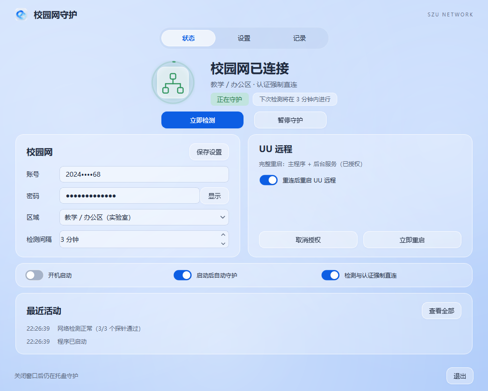
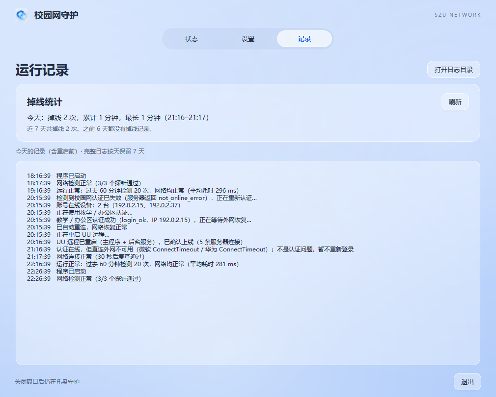
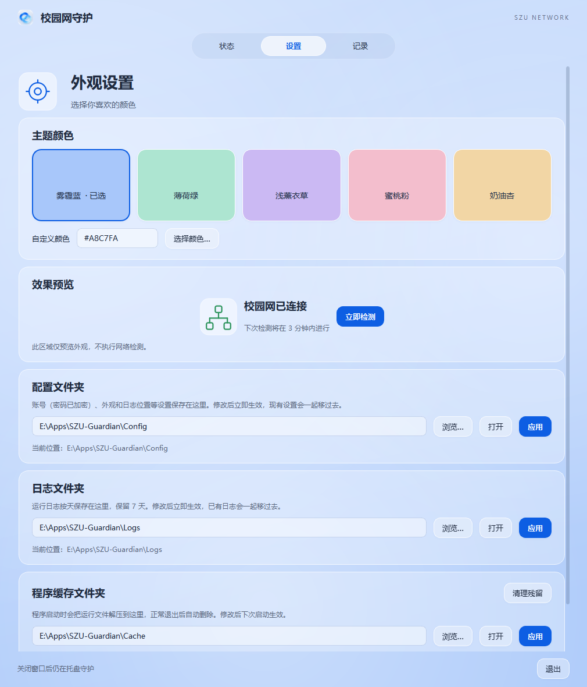
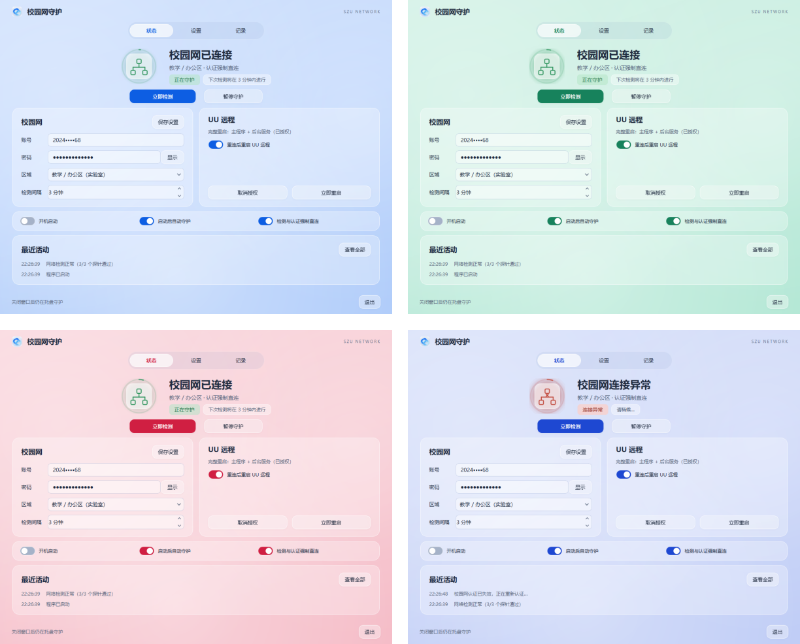
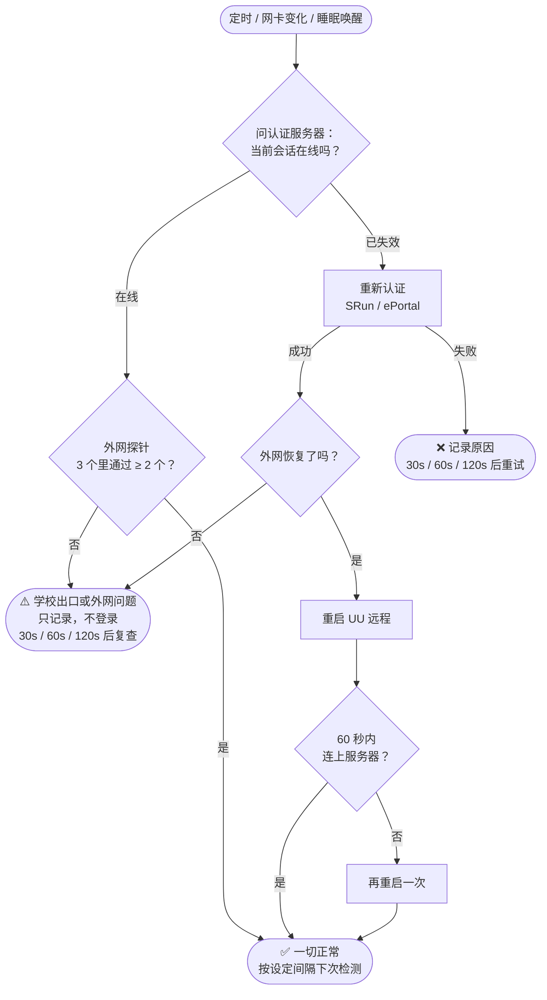
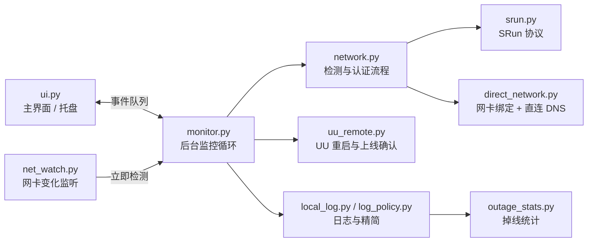

<div align="center">


# 校园网守护 · Glass 版

**深圳大学校园网掉线自动重连 + UU 远程自动恢复**

[](https://github.com/yjie20010419-ship-it/SZU-Guardian-Glass/releases/latest)
[](https://www.python.org/)
[](https://www.microsoft.com/windows)
[](https://doc.qt.io/qtforpython-6/)
[](LICENSE)

[下载](#-快速开始) · [功能](#-功能一览) · [工作原理](#-工作原理) · [常见问题](#-常见问题) · [从源码构建](#-从源码构建)



</div>

---

## 💡 它解决什么问题

实验室的电脑常年开着，用 UU 远程从宿舍或家里连回去干活。可校园网认证隔一段时间就会失效，一旦掉线：

- 电脑上不了网，**远程也连不上**，人又不在实验室，只能干等；
- 就算重新认证上了，UU 远程经常还卡在“离线”，**必须重启才能恢复**。

校园网守护常驻在托盘里，定时检查认证状态。发现掉线就自动重新认证，认证成功后再自动重启 UU 远程并确认它真的上线了。整个过程不需要人在电脑前。

## ✨ 功能一览

<table>
<tr>
<td width="50%" valign="top">

### 🌐 校园网
- 支持**教学/办公区**（深澜 SRun）和**宿舍区**（ePortal）两种认证
- 每次都**直接问认证服务器**会话是否有效，不会被“百度还能打开”骗过
- 只有认证真掉了才登录；外网故障只记录，不乱登录
- 掉线后 30 秒 / 1 分钟 / 2 分钟快速复查
- 插拔网线、WiFi 重连、睡眠唤醒后**立即检测**

</td>
<td width="50%" valign="top">

### 🖥️ UU 远程
- 重新认证成功后，自动重启主程序和后台服务
- 重启后检查 `GameViewerServer.exe` 是否连上服务器
- 60 秒内没连上，自动再重启一次
- 只需授权一次，之后全自动

</td>
</tr>
<tr>
<td valign="top">

### 🛡️ 安全与抗干扰
- 检测和认证**绑定物理网卡直连**，Clash、FlClash 等代理的 TUN / Fake-IP 模式不会干扰
- HTTPS **严格校验证书**，校验失败直接停止，绝不发出密码
- 密码用 Windows DPAPI 加密保存，只有本机本账号能解开

</td>
<td valign="top">

### 📋 诊断与记录
- 记录认证服务器的返回码和账号的**在线设备列表**，能看出是不是被别的设备挤下线
- 正常时每小时只写一句汇总，出事时详细记录
- **掉线统计**：今天掉了几次、共多久、最长一次，以及近 7 天的情况

</td>
</tr>
</table>

## 📸 界面

<table>
<tr>
<td width="50%" align="center"><br><sub><b>记录页</b>：掉线统计 + 当天完整日志（重启程序也不会丢）</sub></td>
<td width="50%" align="center"><br><sub><b>设置页</b>：主题颜色、配置/日志/缓存文件夹都可以自己选</sub></td>
</tr>
</table>

**五种主题色，也可以自定义颜色。** 换色带过渡动画，Windows 标题栏也会跟着变色。状态图标在线时绿色“呼吸”，检测时转圈，掉线时变红，外圈显示距下次检测还有多久。

<div align="center">

<br><sub>雾霾蓝 · 薄荷绿 · 蜜桃粉 · 掉线时的样子</sub>
</div>

托盘图标上的小圆点也表示状态：🟢 正常 · 🔴 掉线 · 🟠 检测中 · ⚪ 已暂停。

## 🚀 快速开始

1. 到 [Releases](https://github.com/yjie20010419-ship-it/SZU-Guardian-Glass/releases/latest) 下载 `SZU-Guardian-Glass-vX.Y.Z.exe`（单文件，约 30 MB，不用安装）。
2. 把 exe 放到一个**长期保留**的位置，双击运行。
3. 填写**学号**和**统一身份认证密码**，选择所在的网络区域，检测间隔建议 3～5 分钟。
4. 如果开着代理软件，保持“**检测与认证强制直连**”开启。
5. 点击“**开始守护**”。关掉窗口后，程序会留在托盘里继续运行。
6. 需要自动重启 UU 远程的话，点“**授权完整重启**”，在弹出的 Windows 提示里确认一次。

> [!IMPORTANT]
> 先把 exe 挪到最终位置，再打开“开机启动”。开机启动记录的是 exe **当前**的路径，之后再挪动就会失效。

> [!TIP]
> 下载后可以对照 Release 里的 `SHA256SUMS` 校验文件：
> ```powershell
> Get-FileHash .\SZU-Guardian-Glass-v1.0.3.exe -Algorithm SHA256
> ```

## 🔍 工作原理

每一轮检测的判断流程：



几个关键设计：

| 设计 | 为什么 |
| --- | --- |
| **以认证服务器为准** | 校园网对百度等网站有白名单，认证掉了也可能打得开。只看网页能不能打开会漏判。 |
| **三个探针、两个通过才算联网** | 用微软、华为、vivo 的联网检测地址。单个网站抽风不会被误判成断网；不跟随跳转，认证页的拦截也不会被当成“已联网”。 |
| **认证在线时不重新登录** | 外网不通但认证正常，说明是学校出口或外部网站的问题，重新登录解决不了，反而会把正在用的连接踢掉。 |
| **绑定物理网卡直连** | 代理软件的 TUN 模式会接管所有流量，Fake-IP 会返回假地址。程序把请求绑定到校园网网卡的 IP，并用校园 DNS 解析域名，绕开代理。 |
| **证书校验绝不放松** | SRun 登录报文里的密码只用服务器下发的 challenge 加密，被截获就能还原。所以证书不对就立刻停止，宁可不登录也不泄露密码。 |

模块之间的关系：



## 📁 文件位置

程序的所有文件都放在同一个文件夹里，默认是 `E:\Apps\SZU-Guardian`（没有本地 E 盘时放在 `%LOCALAPPDATA%\SZUNetworkGuardian`）：

```text
E:\Apps\SZU-Guardian\
├─ Config\   config.json（密码已加密）、appearance.json、log_location.json
├─ Logs\     guardian-YYYY-MM-DD.log，保留 7 天
└─ Cache\    exe 运行时的解压目录，正常退出后自动清空
```

| 内容 | 由什么决定 | 修改后 |
| --- | --- | --- |
| 配置 | 用户环境变量 `SZU_GUARDIAN_DATA_DIR` | 立即生效，旧设置一起搬过去 |
| 日志 | 配置文件夹里的 `log_location.json` | 立即生效，旧日志一起搬过去 |
| 缓存 | 用户环境变量 `SZU_GUARDIAN_CACHE` | 下次启动生效 |

三个位置都可以在“设置”页修改。exe 是单文件程序，每次启动先解压到缓存目录；如果程序被强制结束，残留文件会在下次启动时自动清理，也可以在设置页手动清理。旧版本用过的位置（v1.0.0–v1.0.2 的 `E:\Apps\Cache|Config|Logs\SZU-Guardian`、C 盘的 `%LOCALAPPDATA%`）会在启动时自动迁移。

## ❓ 常见问题

<details>
<summary><b>为什么我只登了两三台设备，还是经常被挤下线？</b></summary>

目前推测是同一账号多台设备互相顶替：电脑、笔记本、手机都连着校园网时，其中一台重新认证，就可能把另一台挤下线（学校没有公开具体规则，这一点还没确认）。程序每次掉线都会记下账号当时的在线设备，可以对照记录页，看看掉线前后是哪台设备登录了。
</details>

<details>
<summary><b>开着 Clash / FlClash 会有影响吗？</b></summary>

保持“检测与认证强制直连”开启就没有影响。程序会绕过代理，直接从校园网网卡发请求，用校园 DNS 解析地址。
</details>

<details>
<summary><b>为什么认证成功了还要重启 UU 远程？</b></summary>

实际使用中发现，网络断开再恢复后，UU 远程的后台服务经常停在“离线”状态，不会自己重连，必须重启才行。所以程序在每次重新认证后都会重启它，并检查它是否真的连上了服务器。只是外网抖动、没有重新登录的话，不会重启 UU。
</details>

<details>
<summary><b>再次双击 exe 会开两个吗？</b></summary>

不会。程序只允许运行一个实例，再次打开时会直接切换到已经在运行的窗口。
</details>

<details>
<summary><b>密码安全吗？</b></summary>

密码用 Windows DPAPI 加密后保存在本地，只有当前电脑上的当前 Windows 账号能解开。日志里不会记录密码和认证报文。认证时严格校验 HTTPS 证书，证书不对就不会发出密码。
</details>

## 🛠️ 从源码构建

需要 Windows x64 和 Python 3.10 以上（当前用 3.14 构建）。

```powershell
.\build.ps1               # 第一次：创建 .venv-build、安装依赖、跑测试、打包
.\build.ps1 -SkipInstall  # 之后：跳过安装依赖
```

打包配置在 `guardian.spec`：单文件、解压到 `%SZU_GUARDIAN_CACHE%`，并去掉用不到的 Qt 组件（软件 OpenGL、翻译文件、多余插件）。成品是 `dist\SZU-Guardian-Glass.exe`，约 30 MB。

只跑测试：

```powershell
.\.venv-build\Scripts\python.exe -m unittest discover -s tests
```

<details>
<summary><b>项目结构</b></summary>

```text
szu_guardian/
  network.py         检测与认证流程、诊断信息
  srun.py            SRun 协议（含在线设备解析）
  direct_network.py  物理网卡绑定与直连 DNS
  monitor.py         后台监控循环
  net_watch.py       网卡地址变化监听
  uu_remote.py       UU 远程重启与上线确认
  log_policy.py      日志精简规则
  outage_stats.py    掉线统计
  local_log.py       本地日志
  cache_dir.py       运行时解压目录
  data_dir.py        配置文件夹
  single_instance.py 防止重复运行
  motion.py          动画控件
  ui.py              主界面
tests/               自动化测试
docs/images/         README 用的截图（界面演示数据，不含真实账号）
guardian.spec        打包配置
```
</details>

## 🔒 隐私

- 源码和 exe 里没有预设任何账号或密码；测试和截图里的 IP 都是示例地址。
- 日志不会记录密码和认证报文，但会记录账号在线设备的 IP，只保存在本机。
- 不要把 `config.json` 上传到公开的地方。

## 🙏 致谢

- [ackness/szu-autoconnect](https://github.com/ackness/szu-autoconnect)、[Sleepstars/SZU-login](https://github.com/Sleepstars/SZU-login)、[vidar-team/srun-login](https://github.com/vidar-team/srun-login)：校园网认证流程和 SRun 协议的参考实现。

第三方组件和许可说明见 [THIRD_PARTY_NOTICES.md](THIRD_PARTY_NOTICES.md) 和 [COMPONENTS.md](COMPONENTS.md)。

## 📄 许可证

[MIT License](LICENSE)。仅用于维护本人账号的正常校园网连接，请遵守学校的网络管理规定。
